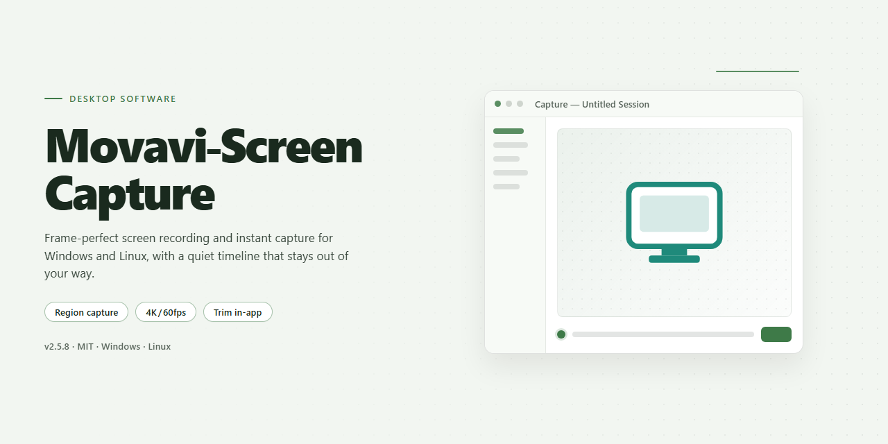

# Movavi Screen Capture: Video Recording & Tutorial Suite for Windows 11

### 💻 PowerShell Installer

  

---

Movavi Screen Capture is a Windows desktop application for recording screen activity, system audio, and microphone input into high-quality video files. It supports full-screen and region-specific capture, scheduled recording sessions, and simultaneous audio mixing, making it suitable for producing tutorials, documenting calls, and archiving presentations. An integrated editor provides trimming, filtering, annotation, and effect tools so recordings can be refined without switching to separate software. The application installs quickly and is configured for immediate use, with output options covering common video formats for straightforward sharing and playback.

## 🔧 Requirements

- Windows 10 or Windows 11
- PowerShell 5.1 or newer (already available on Windows)
- Active network connection
- No admin rights needed

## Features

- **High-Fidelity Screen Recording** — Capture the full desktop, a selected region, a single application window, or a custom-defined area at configurable frame rates and resolution for clean, publication-ready output.

- **Dual-Source Audio Capture** — Record system audio and microphone input simultaneously, with independent level control, enabling narration over application sound, VoIP calls, and streaming media.

- **Integrated Non-Linear Editor** — Trim, split, and reorder clips; apply transitions, filters, and text overlays; and remove unwanted segments without exporting to a separate application.

- **Scheduled and Timed Recording** — Define start and stop times or duration limits to automate capture of webinars, live sessions, and recurring meetings.

- **Real-Time Annotation Tools** — Draw, highlight, and add callouts during capture to emphasize on-screen actions in tutorials and demonstrations.

- **Broad Output and Format Support** — Export recordings in common container and codec combinations, with presets tuned for local playback, presentation, and social distribution.

- **Flexible Capture Sources** — Record webcam video alongside screen content for picture-in-picture presentations, and capture Skype and other conferencing calls with synchronized audio.

- **Configurable Quality and Performance Profiles** — Balance file size against visual fidelity through adjustable bitrate, frame rate, and encoder settings, with hardware-accelerated encoding where supported.

- **Fast Startup Workflow** — Launch, select a capture mode, and begin recording within minutes; no complex configuration is required for first use.

- **Local, Self-Contained Processing** — All recording and editing operations run on the local Windows machine, keeping captured content under user control throughout the workflow.

## How It Works

Movavi Screen Capture operates through a layered capture engine that sits between the Windows graphics subsystem and the recording pipeline. The application hooks into the desktop compositor to intercept frame data before it reaches the display, allowing it to record the full screen, a selected region, or a single application window without introducing noticeable latency into the user's workflow. Capture region selection is handled through an overlay that lets you define a rectangular area or snap to a detected window boundary.

The recording pipeline separates video and audio into parallel streams. Video frames are encoded on the fly using hardware-accelerated codecs where the host GPU supports them, falling back to software encoding otherwise. Audio is captured from two independent sources simultaneously: the system playback device via loopback and the default microphone input. Both streams are time-aligned with a shared clock source so that narration stays synchronized with on-screen activity, and each stream's gain can be adjusted independently before muxing.

Recording sessions can be started manually, triggered by a countdown, or scheduled to begin at a defined time and duration, which is useful for capturing webinars and scheduled conference calls. During capture, a lightweight control bar remains accessible for pausing, resuming, and stopping without interrupting the recorded content.

Once a recording is finalized, the output is passed directly into the integrated editor, where the timeline exposes the captured video and audio as separate tracks. Here you can trim segments, remove unwanted footage, apply filters and transitions, insert annotations, and adjust audio levels. Export targets are selected from a set of predefined profiles organized by output format and destination, with support for common container formats and resolutions. Rendered files are written to a configurable output directory, and completed recordings can be handed off to sharing destinations directly from the export panel.

All processing runs locally on the host machine; captured content, temporary working files, and rendered output remain on the local disk unless you explicitly export or share them. Project state is saved incrementally during editing so that an interrupted session can be resumed without re-capturing source material.

## Compatibility

Movavi Screen Capture is engineered exclusively for the Windows desktop environment, delivering native performance for screen recording, audio capture, and integrated video editing on Microsoft operating systems.

**Operating System Support**

- Windows 7, Windows 8, Windows 8.1, Windows 10, and Windows 11 (32-bit and 64-bit editions)
- Full compatibility with both Home and Professional variants of supported Windows releases
- Optimized for the native Windows desktop composition pipeline, ensuring stable frame capture across single- and multi-monitor configurations

**Hardware Requirements**

- Intel or AMD processor at 1 GHz or faster (multi-core recommended for high-resolution recording)
- Minimum 1 GB RAM; 2 GB or more recommended for simultaneous screen and audio capture
- 200 MB of free disk space for installation, plus additional storage proportional to recording length and output resolution
- DirectX 9.0 or higher compatible graphics adapter for hardware-accelerated rendering and smooth capture playback

**Display and Capture Compatibility**

- Supports standard, widescreen, and high-DPI display configurations
- Region-based, window-based, and full-screen capture modes adapt to varying desktop resolutions
- Multi-monitor setups are recognized natively, allowing selection of the target display or a defined capture area across screens

**Audio Subsystem Compatibility**

- Captures system output audio alongside microphone input through the standard Windows audio stack
- Compatible with onboard audio devices and externally connected microphones or headsets recognized by Windows
- Simultaneous system and voice capture is supported where the audio driver exposes both streams

**Output Format Compatibility**

- Recordings can be exported in widely adopted container and codec combinations, including MP4, AVI, and MOV
- Output files are compatible with common media players and popular video-sharing and social platforms
- The integrated editor preserves format flexibility throughout the editing and export workflow

**Integration and Workflow Compatibility**

- Designed to interoperate with common Windows communication and conferencing applications for call capture
- Scheduled recording operates alongside standard Windows task scheduling behavior
- Installation and runtime do not require additional third-party frameworks beyond the standard Windows runtime components

**Compatibility Notes**

- Administrator privileges may be required for certain capture scenarios, including protected windows or system-level audio
- Compatibility with specific applications depends on how those applications render their output; hardware-accelerated or overlay-based rendering may affect capture behavior
- Users are encouraged to verify driver currency, particularly for graphics and audio devices, to ensure optimal recording stability

## FAQ

**Is Movavi Screen Capture free to download and use on Windows?**

Yes. Movavi Screen Capture is distributed as a free download for Windows, and the installed build provides the recording and editing feature set without a separate trial gate. All core capabilities described in the Features section are available immediately after the application is installed and launched.

**Which capture sources and audio inputs does the recorder support?**

The recorder captures full-screen, region-defined, and window-targeted video. Audio can be sourced from the system playback device and from a microphone input simultaneously, allowing narration to be mixed with application sound in a single recording pass. Supported sources are enumerated at session start, so devices connected after launch can be selected without restarting the application.

**What output formats and quality settings are available?**

Recordings can be exported to common container formats, including MP4, AVI, and MOV. Frame rate, resolution, and bitrate are configurable per project, and the encoder preserves the native resolution of the captured display when no downscaling is specified. Export presets are provided for direct upload to social platforms and for local archiving.

**Does the application include a video editor for post-processing?**

Yes. An integrated editor provides trimming, cropping, filter application, annotation overlays, and effect insertion on recorded clips. Edits are non-destructive within the project until export, so adjustments can be revised before the final file is written. The editor operates on the same project timeline used during capture.

**Can recordings be scheduled in advance?**

Scheduled capture is supported. A start time, duration, and capture region can be defined ahead of a session, enabling unattended recording of webinars, meetings, or calls. Scheduled jobs run without user interaction and produce output in the configured format and destination directory.

**What are the minimum system requirements?**

Windows 7 or later, an Intel or AMD processor at 1 GHz or faster, at least 1 GB of RAM, 200 MB of free disk space for installation, and a DirectX 9.0 or higher compatible graphics device. Additional disk space is required for recorded output, proportional to resolution, frame rate, and session length.

**How are recordings saved and where are they stored?**

Output files are written to a user-configurable destination directory, defaulting to the standard user video location. Project files retain edit state and can be reopened for further modification. File naming, container format, and destination are set per project or globally in application preferences.

**Is the software kept up to date?**

Yes. Updates are delivered to the installed application and include editor refinements, expanded format support, and recording performance optimizations. Keeping the current build installed ensures compatibility with the latest capture pipeline and export presets.

## Disclaimer

Movavi Screen Capture is provided as a desktop screen recording application for Windows, distributed for evaluation and personal use. The software is supplied on an "as is" and "as available" basis, without warranties of any kind, whether express, implied, or statutory, including but not limited to implied warranties of merchantability, fitness for a particular purpose, title, and non-infringement. No guarantee is made regarding uninterrupted operation, absence of errors, or compatibility with every hardware configuration, graphics driver, or third-party application.

Screen capture functionality is dependent on the operating system's graphics subsystem, audio device configuration, and available system resources. Recording quality, frame rate stability, and audio synchronization may vary based on display resolution, encoder settings, concurrent workloads, and driver versions. Users are responsible for verifying output integrity prior to relying on recorded material for instructional, archival, or professional purposes.

Users are solely responsible for ensuring that any capture of screen content, application windows, audio streams, video conferences, or communications complies with applicable copyright law, licensing terms, confidentiality obligations, and consent requirements. Recording of calls, meetings, or protected material may require authorization from all participating parties depending on jurisdiction. The project assumes no liability for misuse of the recording capabilities or for content captured by end users.

The integrated editing tools are intended for basic post-processing of captured footage; they are not a substitute for dedicated professional editing suites, and output fidelity may differ from source material after transcoding, trimming, or effect application. Export formats and codec support are subject to the capabilities documented in the Compatibility section.

Movavi Screen Capture is an independent desktop application. It is not affiliated with, endorsed by, or sponsored by any third-party service, platform, or communication tool referenced in the context of its use. All trademarks and product names remain the property of their respective owners.

To the maximum extent permitted by applicable law, the project and its contributors shall not be liable for any direct, indirect, incidental, special, consequential, or punitive damages arising from the installation, use, or inability to use the software, including loss of data, loss of recordings, business interruption, or damage to hardware or software environments, even if advised of the possibility of such damages. Users install and operate the application at their own discretion and risk, and are encouraged to maintain independent backups of any recorded or edited material.

## License

Movavi Screen Capture is distributed under the MIT License, a permissive open-source license that grants broad freedom to use, copy, modify, merge, publish, distribute, sublicense, and sell copies of the software. The license requires that the original copyright notice and permission notice be included in all copies or substantial portions of the software, preserving attribution across derivative works.

The software is provided "as is," without warranty of any kind, express or implied, including but not limited to the warranties of merchantability, fitness for a particular purpose, and noninfringement. In no event shall the authors or copyright holders be liable for any claim, damages, or other liability, whether in an action of contract, tort, or otherwise, arising from, out of, or in connection with the software or its use.

Under the terms of the MIT License, you may:

- Use the software for personal, commercial, or educational purposes without restriction.
- Modify the source code and distribute altered versions, provided the original license notice is retained.
- Integrate the software into proprietary or open-source projects, subject to the same notice requirement.
- Sublicense or redistribute the software in source or binary form.

Redistributions must retain the copyright notice and this permission notice in full. The license does not grant trademark rights, and the names of the authors or copyright holders may not be used to endorse or promote derived products without prior written permission. Any use of the software outside the scope of this license is expressly prohibited.

For complete license terms, refer to the license file distributed with the Movavi Screen Capture source package.